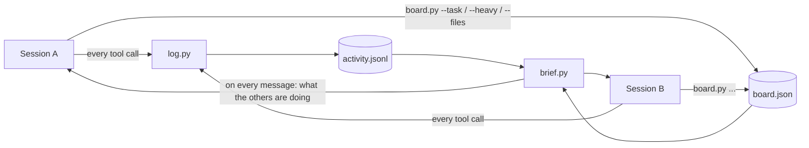

<div align="center">

# claude-sessions-board

**Run several Claude Code sessions on one project without them stepping on each other.**

[](LICENSE)


</div>

You open a second Claude Code session to go faster. Ten minutes later, both edited the same file, two renders run at
once and the machine crawls, and neither session knows what the other one did.

**claude-sessions-board** gives every session a live view of the others, injected into its context on every message:
who is doing what, which shared files are being written, and whether a heavy CPU/GPU job is running.
Three small hook scripts, Python standard library only, no server, nothing leaves your machine.

I run it every day with 3 to 5 sessions in parallel on a video-editing project (one per topic: editor, render engine,
audio lab…).

## What each session sees

```
[Session board 14:31:17] Your session: 3f9c2a71-... - your row: {"name": "editor", "task": "timeline drag & drop", ...}
- Session "render lab" (5d1e8b04) - task: memory guard - HEAVY JOB RUNNING: GPU render (~3 min) - last action at 14:31:15
    14:31:08 Edit file_path: src/render.mjs
    14:31:15 Bash description: Measure memory before the render
- Session "docs" (a72c6e19) - task: user guide - writing shared files: docs/STATE.md - no action for 20 min
Rules: one heavy job (CPU/GPU) at a time when possible; never write a file another session lists as being written; ...
```

So the editor session waits for the render to finish before starting its own, and stays away from `docs/STATE.md`.

## How it works



| File | Hook | Role |
|---|---|---|
| `board.py` | (command) | Each session's row: name, task, heavy job, files being written. Atomic writes. |
| `log.py` | `PostToolUse` | One line per tool call in `activity.jsonl`, rotated at 2 MB. Never blocks, never fails. |
| `brief.py` | `SessionStart`, `UserPromptSubmit` | The summary of the other sessions: last 20 minutes, 4 actions each, then your rules. |

## Install (2 minutes)

1. Copy `.claude/coordination/` into your project.
2. Merge [`.claude/settings.json`](.claude/settings.json) (three hooks) into yours. `python` must be on the PATH
   (write `python3` if that is its name on your machine).
3. Tell your sessions to use the board, for example in `CLAUDE.md`:

   ```
   Several Claude Code sessions work here in parallel. Declare yourself at the start and keep your row up to date:
   python .claude/coordination/board.py <your session id> --name ... --task ... [--heavy ...] [--files ...]
   Use --free when a heavy job ends and --end when you leave. Sub-agents do not declare themselves.
   ```
4. Add `.claude/coordination/board.json` and `.claude/coordination/activity.jsonl*` to `.gitignore`.

Each session learns its own id from the first brief, so it can declare itself right away.

## Board commands

```bash
python .claude/coordination/board.py <id> --name "render lab" --task "export v3"
python .claude/coordination/board.py <id> --heavy "GPU render until 21:15"   # others wait
python .claude/coordination/board.py <id> --free                             # heavy job done
python .claude/coordination/board.py <id> --files "docs/STATE.md, src/api/"  # hands off
python .claude/coordination/board.py <id> --end                              # leaving
python .claude/coordination/board.py --show                                  # the whole board
```

## Your own rules

Write them in `.claude/coordination/rules.txt`; they replace the default rules line. For example:
`Rules: only the "db" session runs migrations; each session writes only its own section of docs/STATE.md.`

## FAQ

**Sub-agents?** They share their parent's session id. If one declares itself anyway, it goes into a `sub_agent`
field and never overwrites its parent's row.

**Windows, macOS, Linux?** All three. The output is pure-ASCII JSON, so the Windows console never breaks accents.

**Does it slow Claude down?** Each hook reads at most the last 200 KB of the log: about 0.1 s per message on a
laptop, Python start-up included.

**Privacy?** Everything stays in two local files in your project. No network call.

## Test

```bash
python -m unittest discover tests
```

## License

[MIT](LICENSE)
